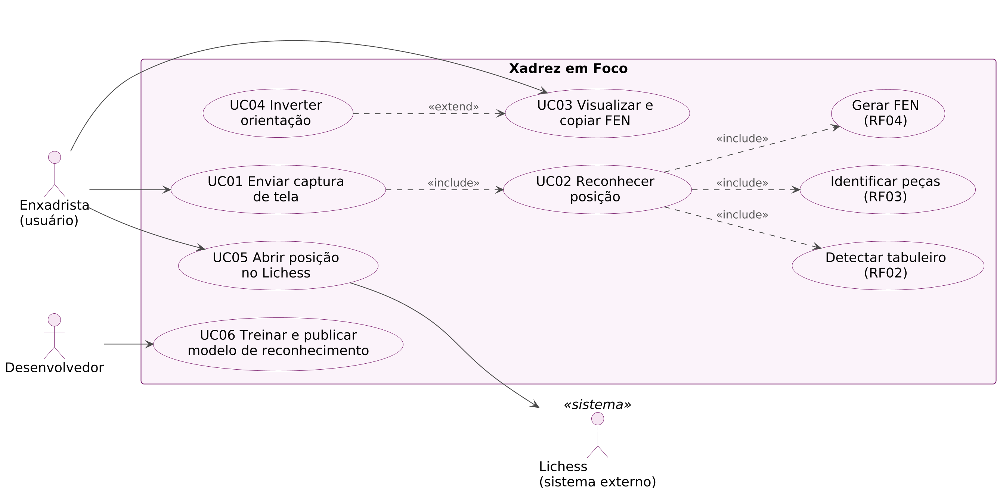
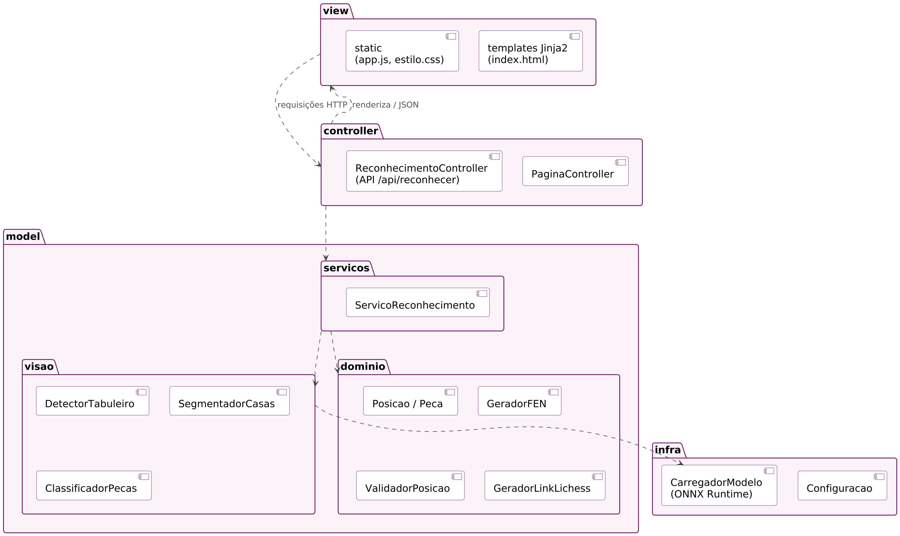
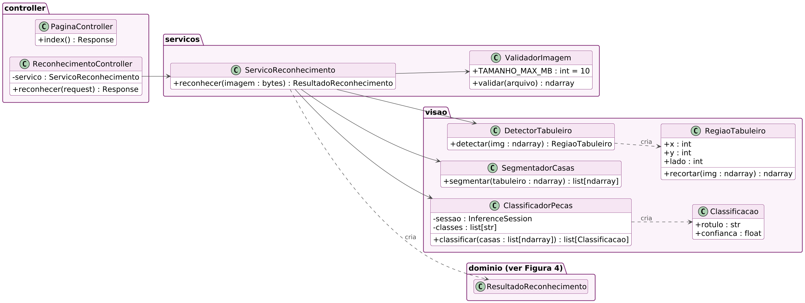
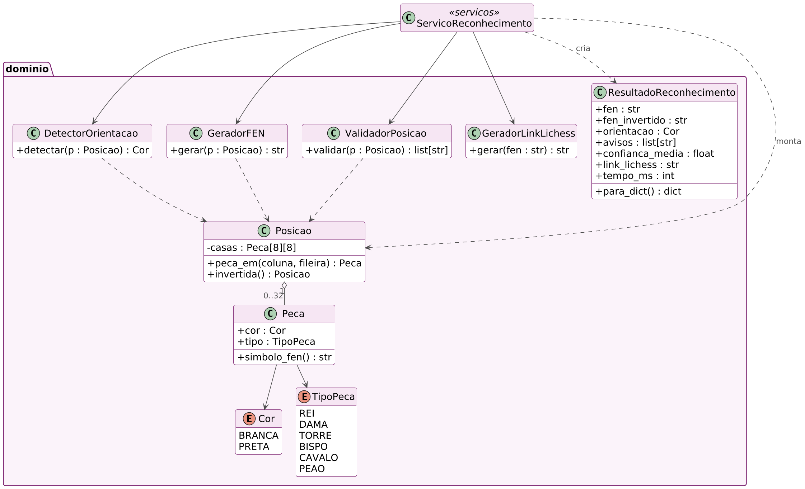
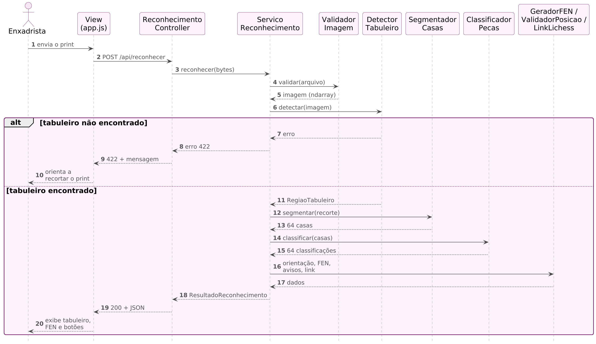
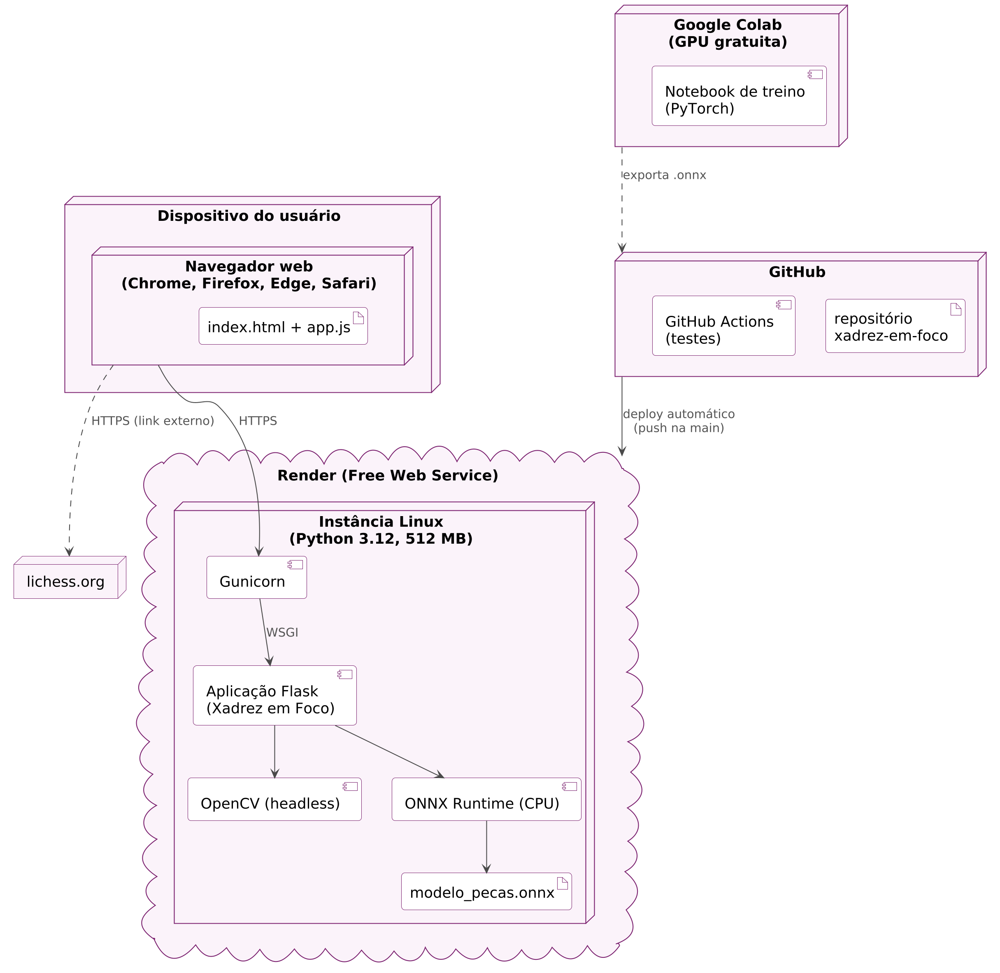
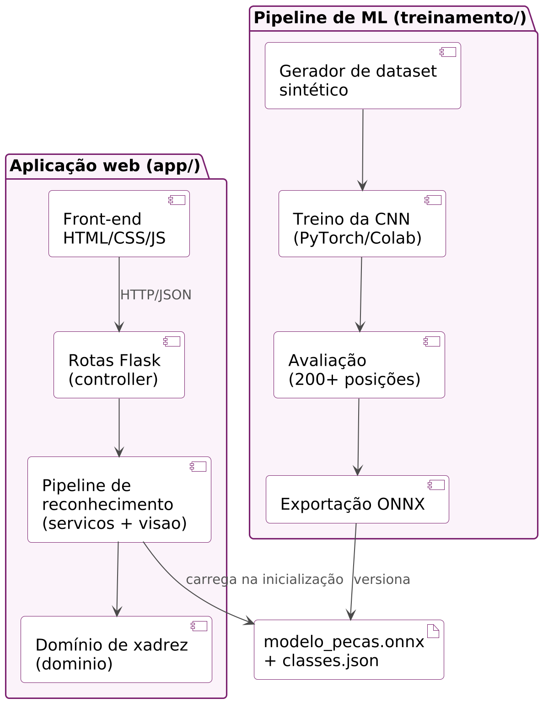
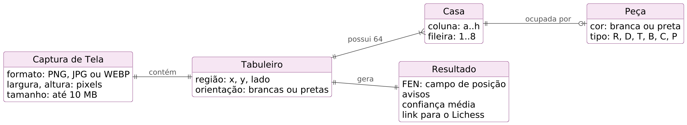

# Arquitetura

Resumo do [Documento de Arquitetura de Software](Aula-08-PI_II-Documento%20de%20Arquitetura%20de%20Software.docx) (v1.0, Sprint 3). A stack foi definida nesta sprint; as decisões e alternativas estão registradas nos [ADRs](decisoes/README.md).

## Contexto técnico

- Aplicação web acessada pelo navegador (desktop e celular), sem cadastro e sem instalação.
- Projeto individual, prazo final em 23/11/2026, somente ferramentas gratuitas.
- Entrada: captura de tela PNG, JPG ou WEBP de até 10 MB. Saída: campo de posição do FEN e link para o Lichess.
- Metas: resposta em até 3 s com o servidor ativo; acerto mínimo de 90% das peças; memória de até 400 MB (limite da instância: 512 MB).

## Componentes

A aplicação segue o padrão MVC adaptado ao Flask:

| Pacote | Papel | Responsabilidade |
| --- | --- | --- |
| `templates/`, `static/` | View | Página única: envio do print, progresso, resultado e erros |
| `controller/` | Controller | `GET /` (página) e `POST /api/reconhecer` (API JSON) |
| `servicos/` | Model | Orquestra o pipeline de reconhecimento |
| `visao/` | Model | Detecção do tabuleiro, recorte das 64 casas e classificação das peças |
| `dominio/` | Model | Peça, posição, geração e validação do FEN, orientação, link do Lichess |
| `infra/` | — | Configuração e carregamento único do modelo ONNX |

Pipeline de reconhecimento: validação da imagem → detecção do tabuleiro (OpenCV) → normalização para 512×512 e recorte em 64 casas de 64×64 → classificação em lote de 13 classes (CNN via ONNX Runtime) → orientação → geração do FEN → validação da posição (avisos) → link do Lichess.

Fora da aplicação web existe o **pipeline de treinamento** (`treinamento/`): gera o dataset sintético, treina a CNN no Google Colab, avalia com os prints reais e exporta o modelo em ONNX.

## Integrações

| Sistema | Finalidade | Risco / dependência |
| --- | --- | --- |
| Lichess | Análise da posição, apenas por link (`https://lichess.org/analysis/standard/<FEN>`) | Baixo: sem API; o formato da URL deve ser verificado nos testes (PB20) |
| Render | Hospedagem gratuita com deploy automático a partir da `main` | Hiberna após 15 min sem tráfego; cerca de 1 min para voltar |
| GitHub Actions | Testes automatizados a cada push | Baixo |
| Google Colab | GPU gratuita para treino | Limite de uso da GPU gratuita; sessões podem ser interrompidas (salvar checkpoints) |

## Dados

- A aplicação **não tem banco de dados** ([ADR-005](decisoes/ADR-005-aplicacao-sem-banco-de-dados.md)).
- A imagem enviada fica apenas em memória durante a requisição e não é gravada em disco nem em log.
- Persistidos em arquivo: `modelos/modelo_pecas.onnx`, `modelos/classes.json` e o gabarito de teste (`arquivo, fen_esperado, plataforma, tema, lado_baixo`). O dataset de treino fica fora do repositório (Google Drive), por ser volumoso.
- Os prints do parceiro são usados somente para teste e validação, com a autorização registrada no termo de anuência. Como prints de plataformas podem mostrar nomes de usuário, só entram no repositório versões com esses nomes ocultos ou o recorte do tabuleiro.

## Decisões técnicas

| ADR | Decisão |
| --- | --- |
| [001](decisoes/ADR-001-entrada-apenas-captura-de-tela.md) | Entrada apenas por captura de tela no MVP |
| [002](decisoes/ADR-002-python-flask-mvc.md) | Python 3.12 + Flask em MVC |
| [003](decisoes/ADR-003-grade-8x8-cnn-por-casa.md) | Reconhecimento por grade 8×8 + CNN por casa |
| [004](decisoes/ADR-004-onnx-runtime-em-producao.md) | ONNX Runtime para executar o modelo em produção |
| [005](decisoes/ADR-005-aplicacao-sem-banco-de-dados.md) | Aplicação sem banco de dados |
| [006](decisoes/ADR-006-hospedagem-render.md) | Hospedagem na camada gratuita do Render |
| [007](decisoes/ADR-007-dataset-sintetico-e-prints-reais.md) | Dataset sintético para treino e prints reais para teste |
| [008](decisoes/ADR-008-rf05-essencial.md) | RF05 reclassificado como Essencial |
| [009](decisoes/ADR-009-tratamento-da-orientacao.md) | Tratamento da orientação do tabuleiro (UC04) |

## Riscos

| Risco | Impacto | Mitigação |
| --- | --- | --- |
| Acurácia abaixo da meta com peças de plataformas não vistas no treino | FEN incorreto | Diversificar o dataset; avaliar incluir parte dos prints reais no treino |
| Falha na detecção do tabuleiro | Nenhum resultado | Validação pelo padrão 8×8; mensagem orientando o recorte |
| Memória acima de 512 MB | Aplicação reiniciada pela hospedagem | ONNX Runtime em vez de PyTorch; OpenCV headless; 1 processo |
| Hibernação do servidor | Primeiro acesso lento | Acessar o serviço antes das demonstrações |
| Prazo de projeto individual | Atraso do MVP | Itens Desejáveis adiáveis sinalizados no backlog |

## Diagramas e relação com ADRs

Fontes em PlantUML e imagens em [diagramas/](diagramas/). Para abrir as fontes, use a extensão PlantUML do VS Code ou o plugin do IntelliJ, mantendo o `_style.iuml` na mesma pasta.

| Diagrama | Visão | ADRs relacionados |
| --- | --- | --- |
|  | Casos de uso | 001, 008, 009 |
|  | Lógica (MVC) | 002 |
|  | Lógica | 002, 003, 004 |
|  | Lógica | 009 |
|  | Processos | 003 |
|  | Implantação | 004, 006 |
|  | Implementação | 004, 007 |
|  | Dados | 005 |
