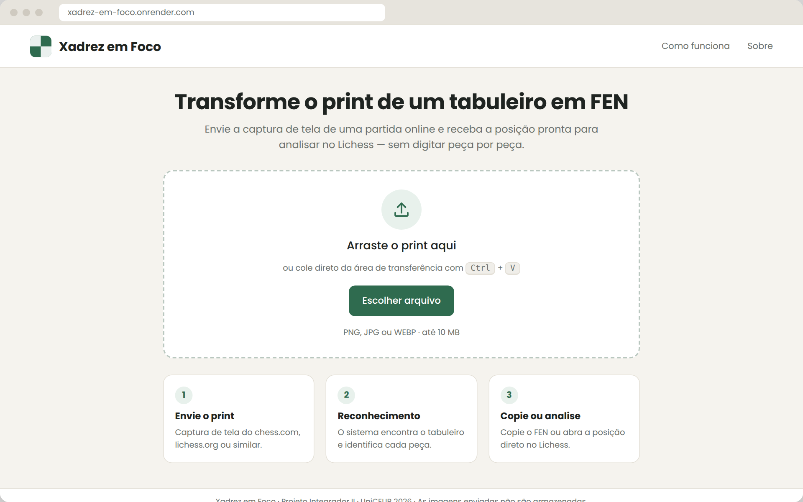
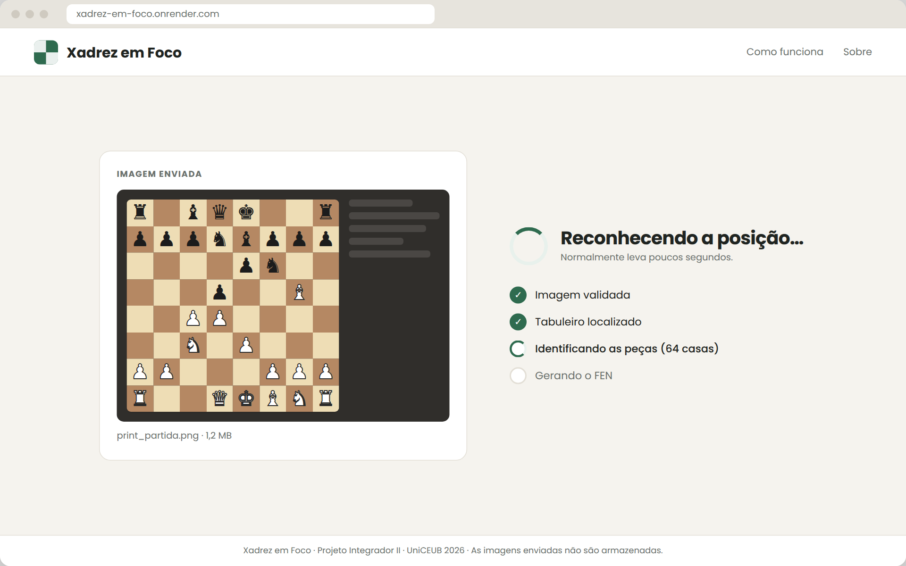
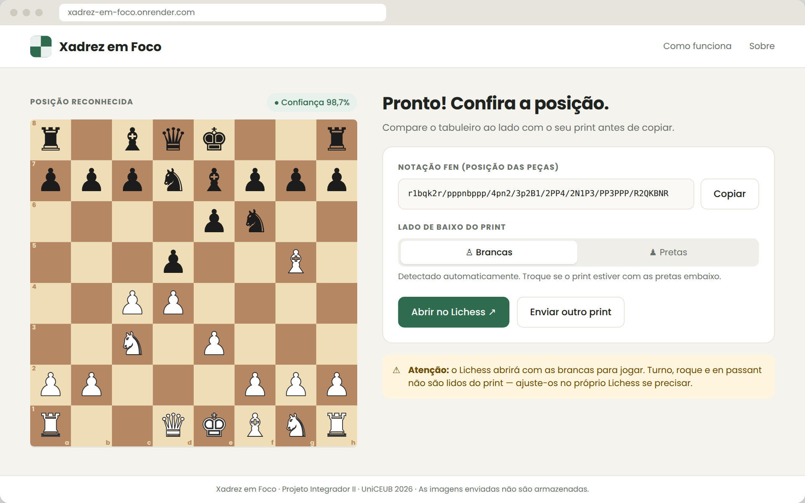
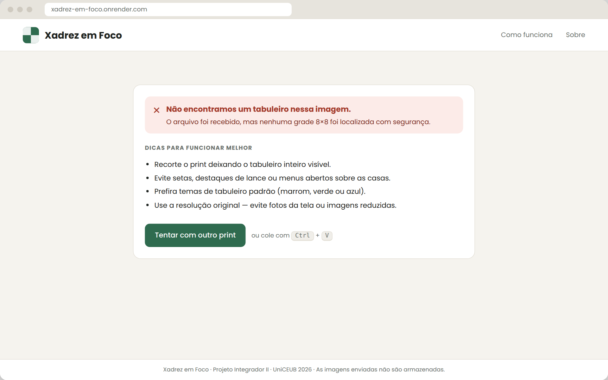
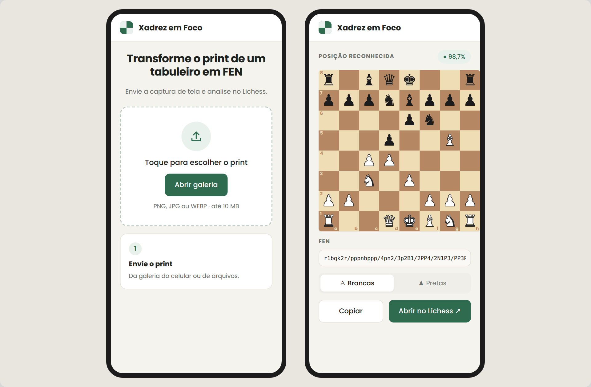

# Protótipo

Protótipo de alta fidelidade das telas do Xadrez em Foco, em HTML e CSS. Abra `prototipo.html` no navegador para ver todas as telas; `roadmap.html` gera o infográfico do roadmap.

| Tela | Imagem |
| --- | --- |
| Inicial (UC01) |  |
| Processando (UC02) |  |
| Resultado (UC03, UC04, UC05) |  |
| Erro |  |
| Celular |  |
